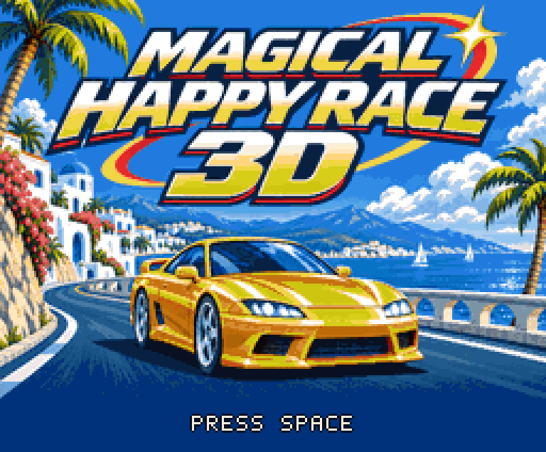
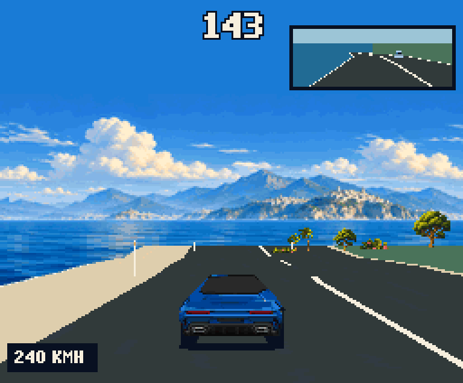

# MAGICAL HAPPY RACE 3D

**遊べるデモ最終版 / Final playable demo — v0.2.0-demo-final**

[ダウンロード / Downloads](https://github.com/kanon-ai/MAGICAL-HAPPY-RACE-3D/releases/tag/v0.2.0-demo-final) · [実行方法 / Running](docs/RUNNING.md) · [ソースと再現 / Source and reconstruction](docs/BUILDING.md) · [English](#english)



## 日本語

MSX turbo R + V9968 + Geo3D V2向けの、景色と音楽を楽しむ公道ドライブゲームです。**実際にアクセル・ブレーキ・操舵を操作して遊べます。**

今回で基本機能をまとめた「遊べるデモ」を一区切りとします。**製品完成版ではなく、制限時間や難易度などのゲームバランスは今後調整します。**

- 海岸、岩場、森林、雪景色、都市、夜景へ続く全6ステージ。検証走行では約12分強。
- カーブ・起伏・岩トンネル・街のトンネルと、車線変更する一般車・トラック。
- チェックポイントで制限時間を延長。時間内にゴールを目指します。
- 運転席／背面視点、バックミラー、選択色に連動するボンネット。
- 車体色は黒・赤・青・黄。タイトル後のメニューでBGM1～3を試聴・選択できます。
- 明確な接触には火花・PSG衝突音・約1.5秒の停止。中央すり抜けの余地も残しています。
- タイトルは無音。メニューからOPLL BGMが始まり、走行中はPSGエンジン音が重なります。



[機能紹介動画・実際のBGMと効果音 / Feature video with actual game audio](https://github.com/kanon-ai/MAGICAL-HAPPY-RACE-3D/releases/download/v0.2.0-demo-final/MAGICAL_HAPPY_RACE_3D_FEATURE_DIGEST.mp4)

### 入手・操作

Releaseの `MAGICAL_HAPPY_RACE_3D_DEMO_FINAL.zip` を展開し、Geo3D V2・V9968対応版openMSXと、適法に入手したBIOSを別途用意してください。通常版openMSXでは実行できません。

```powershell
python tools/play.py --openmsx "C:/path/to/compatible-openmsx/openmsx.exe"
# 外付け88h版
python tools/play.py --openmsx "C:/path/to/compatible-openmsx/openmsx.exe" --external-88h
```

| 操作 | キー |
|---|---|
| タイトルから進む／開始・アクセル | Space |
| 操舵 | ← / → |
| ブレーキ | X |
| 運転席／背面視点 | C |
| BGM選択 | 1 / 2 / 3 |
| 車体色選択 | 5 / 6 / 7 / 8 |
| ポーズ・復帰 | Esc |
| ポーズ中にメニューへ | X |

BGMと車体色は開始前のメニューで選ぶのが基本です。走行中の切替も可能です。選曲時は一瞬止まることがあります。

### 検証・対応環境

4MiB ASCII16 ROM、R800、RAM 256KiB以上、V9968（256色EPAL・256KiB VRAM）、Geo3D V2、OPLL/MSX-MUSICが必要です。**内蔵98h版／外付け88h版**を別々に同梱しています。

対応版openMSXで両版の全6ステージ完走を確認しました。岩トンネル付近で停止する不具合も修正済みです。追加の自動キー操作テストでは合計8回／12回の接触後も完走し、残り106秒／98秒でした。これは人の操作による平均難易度や実機性能を保証する数値ではありません。[検証記録](docs/final-demo-validation.json)・[衝突ありの記録](docs/collision-allowance.json)

実機・FPGA・BlueMSX+は未検証です。一般車の近距離表示などには粗さが残り、後方からの衝突判定はありません。処理速度は環境や場面で変化し、時計は競技記録用ではありません。順位を競うモードはありません。BIOS・エミュレーター・FPGAデータは同梱しません。

### 音楽・ライセンス・免責

BGMはSunoプレミアムアカウントで制作した曲をMSX音楽エディタでOPLL向けに編曲しています。メニュー表記はBGM1・BGM2・BGM3です。画像にはAI生成画像と加工素材を使用しています。

コードは[MIT](LICENSE)。素材・音楽・ROM全体には[別の利用条件](ASSET_LICENSE.md)が適用されます。無料プレイ、条件に沿った無改変再配布、実況・プレイ動画公開が可能です。素材や音楽の単体再利用・販売は別途許可が必要です。[クレジット](THIRD_PARTY_NOTICES.md)

本作は現状有姿・無保証です。動作、互換性、性能、正確性、継続開発を保証しません。利用に伴う損害について、適用法で認められる範囲で責任を負いません。法令上免責できない責任を排除するものではありません。

## English

MAGICAL HAPPY RACE 3D is a scenic public-road driving game for **MSX turbo R + V9968 + Geo3D V2**. It is **actually playable**, with acceleration, braking and steering.

This release concludes the current playable-demo feature set. **It is not the finished commercial game: time limits and difficulty balancing remain future work.**

Six connected stages take you through coast, canyon, forest, snow, city and night scenery, with bends, hills, tunnels, lane-changing traffic and trucks. Reach checkpoints to extend your time and finish before the timer expires. Cockpit/chase views, a rear-view mirror, four body colors and three selectable OPLL tracks are included. Clear contacts produce sparks, a PSG impact sound and approximately 1.5 seconds at zero speed. The title is silent; music starts in the menu. PSG engine sound accompanies driving.

### Download and controls

Extract `MAGICAL_HAPPY_RACE_3D_DEMO_FINAL.zip` from Releases. Supply a **V9968/Geo3D V2-capable openMSX build** and legally obtained BIOS files separately. Standard openMSX cannot run this demo. Use the commands above; add `--external-88h` for external V9968. See [Running](docs/RUNNING.md).

| Action | Key |
|---|---|
| Continue / start / accelerate | Space |
| Steer | Left / Right |
| Brake | X |
| Cockpit / chase | C |
| Select BGM | 1 / 2 / 3 |
| Select body color | 5 / 6 / 7 / 8 |
| Pause / resume | Esc |
| Return to menu while paused | X |

Choose music and color before starting; in-game changes are also available. Music changes may briefly pause the game.

### Requirements and verification

4MiB ASCII16 ROM, R800, at least 256KiB RAM, V9968 with 256-color EPAL and 256KiB VRAM, Geo3D V2, and OPLL/MSX-MUSIC. Separate internal-98h and external-88h editions are included.

Both editions completed all six stages in compatible openMSX, taking approximately 12 minutes in the test drive. The canyon-tunnel freeze is fixed. Two additional automated keyboard-input runs finished with 8 and 12 contacts, leaving 106 and 98 seconds. These are limited automated tests, not a human-difficulty estimate or a hardware performance guarantee.

Physical hardware, FPGA hardware and BlueMSX+ remain unverified. Close-up traffic rendering still has rough edges; collisions from behind are not implemented. Performance varies by scene and environment; the clock is not intended for competition timing. There is no competitive ranking mode. BIOS, emulators and FPGA firmware are not bundled.

### Music, license and disclaimer

The music was created using a Suno premium account and arranged for OPLL with an MSX music editor. The menu labels are BGM1, BGM2 and BGM3. Visuals include AI-generated artwork and edited assets.

Code is under [MIT](LICENSE). [Separate terms](ASSET_LICENSE.md) cover artwork, music, game data and the combined ROM. Free play, unchanged redistribution under those terms, and gameplay videos/streams are permitted. Standalone asset/music reuse and sales require separate permission. See [credits](THIRD_PARTY_NOTICES.md).

Provided **AS IS, WITHOUT WARRANTY**. Operation, compatibility, performance, accuracy and continued development are not guaranteed. To the extent permitted by applicable law, we are not liable for damages arising from use. Nothing excludes liability that cannot legally be excluded.
